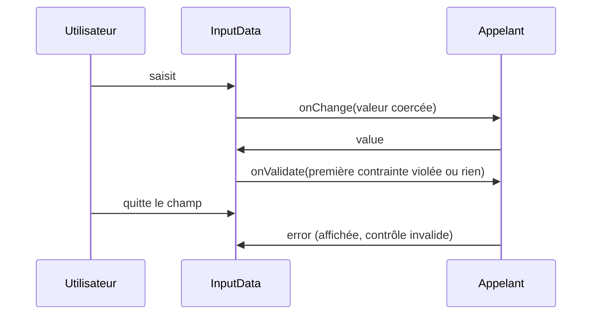
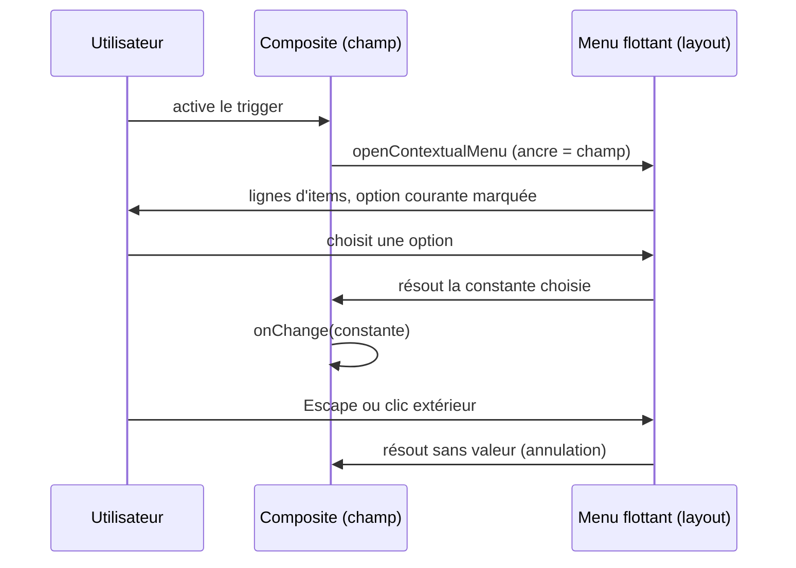

# Spec — Champs de saisie (@jointhedots/input)

Le package input fournit le champ de saisie du système : `InputData`,
piloté par un schéma JSON. Il n'existe qu'une seule famille de gabarits
(`jtd-field*`), habillée par les tokens `--jtd-*` du thème — tout champ
passe par le schéma, y compris le champ texte simple.

## Le champ

Un champ est un **libellé**, un **contrôle**, puis ses **notes** : une aide
et, le cas échéant, une erreur. Le contrôle vit dans un **composite** : la
boîte bordée qui enveloppe l'icône gauche, le widget de saisie et le
tooling droit. Le composite est la source unique de la hauteur du champ ;
les widgets intérieurs sont nus (ni bordure ni fond) et le focus se lit sur
la boîte. La case booléenne et les groupes de choix échappent au
composite : une coche seule ou une liste d'options dans une boîte bordée
serait du bruit.

Un champ expose une **taille** — `xs`, `sm`, `md` (défaut), `lg`, les
mêmes déclinaisons que les icônes. La taille met à l'échelle le composite
(hauteur, police, espacements) ; par héritage de la fonte, tout ce qu'il
contient suit — icône, pastilles de tooling, chevron du déroulant, texte
du widget. Elle ne change ni le widget choisi par le schéma, ni son
comportement : c'est une métrique, pas une variante.

## Étiquetage accessible

Chaque champ est nommé et décrit structurellement, jamais par simple
juxtaposition visuelle : le libellé est l'étiquette native du contrôle (la
légende d'un groupe de choix), l'aide et l'erreur sont rattachées au
contrôle comme descriptions, et une erreur présente marque le contrôle
invalide et s'annonce. Un identifiant stable, fourni ou généré, porte ces
liaisons.

## Pilotage par schéma

`InputData` est entièrement contrôlé (`value` + `onChange`) et ne décide
rien seul : c'est le **schéma** — un sous-ensemble typé de JSON Schema
défini par le package — qui choisit le widget. Le changement coerce la
valeur au type du schéma : un schéma numérique produit toujours un nombre
(ou l'absence de valeur quand le champ est vidé), jamais sa représentation
textuelle ; un champ fichier produit le fichier choisi. Le schéma est un
contrat de données, pas une suggestion.

- **Texte** : le `format` devient le type du contrôle natif (`email`,
  `password`, `search`, `tel`, `url`, `date`, `time`… ; `date-time` désigne
  la date et l'heure locales). Deux formats désignent un autre widget :
  `textarea` (zone multi-ligne, hauteur fixe ou suivant le contenu) et
  `file` (choix d'un fichier, filtré par le type de contenu attendu).
- **Nombre** : bornes et pas du schéma deviennent ceux du contrôle.
- **Booléen** : une case à cocher portant son libellé.
- **Choix restreints** (voir plus bas) : un seul choix, ou plusieurs quand
  le schéma est un tableau dont les éléments portent les choix.

Les contraintes de chaîne (longueurs, motif) et de nombre sont aussi
reportées sur le contrôle natif.

### Texte fantôme et valeur par défaut

Le texte fantôme d'un champ vide est un **exemple** : celui fourni par
l'appelant, sinon le premier exemple du schéma. La valeur par défaut du
schéma n'est jamais affichée comme texte fantôme : une valeur par défaut
est une donnée que l'appelant applique, un exemple n'est qu'une
indication.

## Validation

La validation confronte une valeur au schéma et à l'obligation de saisie,
et rend la **première contrainte violée** — un code stable et un message —
ou l'absence d'erreur. Les contraintes vérifiées sont : l'obligation
(valeur vide, y compris une sélection vide), les longueurs et le motif
d'une chaîne, les formats `email`, `url` et `uri`, le caractère entier,
les bornes d'un nombre, et le nombre d'éléments d'une sélection multiple.
Une valeur vide non obligatoire est valide.

Le champ calcule cette validation à chaque changement de valeur, de schéma
ou d'obligation et la remonte à l'appelant ; il ne l'affiche jamais seul.
L'appelant décide du moment où l'erreur devient visible (sortie du champ,
soumission) en la repassant au champ.

## Choix restreints

Les choix d'un schéma sont soit des constantes **titrées** — le titre est
affiché, la constante est la valeur échangée — soit une énumération de
valeurs affichées telles quelles. Leur présentation est un choix de
l'appelant :

- **déroulant** (défaut) : une instance du **modèle d'items** de
  @jointhedots/layout. Le trigger est un bouton du composite affichant le
  titre courant (ou le texte fantôme) et un chevron ; son ouverture affiche
  un menu contextuel flottant ancré sous le champ, dont chaque option est
  une ligne compacte d'item. L'option courante est marquée comme telle et
  cochée ; choisir une option ferme le menu puis propage la valeur ;
  annuler (Escape, clic extérieur) laisse la valeur inchangée ;
- **radios** ou **contrôle segmenté** : toutes les options visibles, un
  seul choix ;
- **cases à cocher** : imposées par un schéma tableau — la valeur est la
  liste des constantes cochées, dans l'ordre des options.

## Tooling du champ

Les actions d'un champ suivent exactement le **modèle de tooling** du
système d'items : chaque action est un `ToolingProps` (un `LabelProps`
augmenté du drapeau `optional`), défini dans @jointhedots/layout. Le
tooling d'un champ, d'une ligne d'item ou d'un panneau partage donc le
même vocabulaire — `name`, `icon`, `summary`, `onActivate(label, dock)` —
et le même rendu délégué : pastilles activables, les entrées
`optional` étant regroupées derrière un bouton de débordement.
`onActivate` reçoit un dock flottant ancré à la source du clic, ce qui
permet à une action de champ d'ouvrir un menu ou une bulle sans
positionnement à sa charge.

## Le constructeur de champ texte

Construire à la main le schéma d'un champ texte (type, format, exemple)
répète de la connaissance du rendu chez l'appelant. Le constructeur
`TextInputSchema(placeholder, type)` la centralise : il reçoit le texte
fantôme, qu'il place en exemple, et le type de contrôle HTML, qu'il place
en format. Le champ texte simple n'est donc pas un composant distinct —
c'est un point de vue sur le schéma.

## Frontières

`input` possède son type de schéma et sa validation ; il dépend d'`icon`
(glyphes) et de `layout` (modèle d'items, menus flottants) uniquement. La
dépendance est unidirectionnelle : `layout` ne connaît jamais les champs,
et le graphe reste `theme → icon → button → layout → input`.
